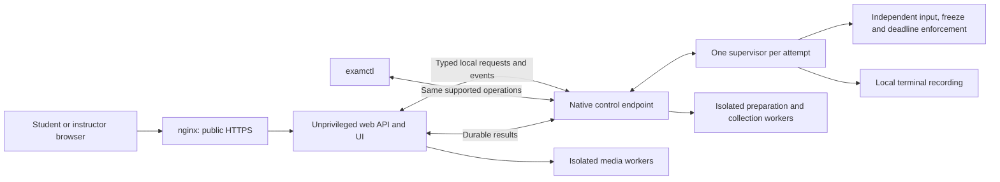

# Simplifying SSH Exam for one permanent host

Evaluation dated November 23, 2026. Source reviewed: local revision `c1482ef`,
the current implementation, and the deployment records linked below. This is a
proposal, not an implementation plan already authorized for execution. No service,
configuration, student record or deadline was changed for this evaluation.

## Recommendation

Make the same-host installation the primary architecture. Replace internal HTTPS
and SSH-carried management with a small, authenticated local control connection.
Deliver committed changes and observations over persistent event streams rather
than repeatedly asking whether anything changed. Keep the web application
unprivileged, retain the attempt supervisors and independent deadline enforcement,
and keep expensive work in separate bounded workers.

Start with **clock changes from the website and examctl**, through the existing
native clock application and back to the instructor's displayed countdown. This
delivers an understandable improvement without first redesigning every subsystem.
Extend the same proven transport to policy, status, saved-work jobs and monitoring.
Consolidating ownership of live attempt state is a later, more consequential step.

The objective should be **no periodic internal discovery polling during healthy
operation**. That includes the one-second clock-change query. It does not mean
removing deadline timers, fresh capture requirements or bounded checks for an
unresponsive participant. Those solve different problems.

## What is already local, and what is still distributed

The web application and its authoritative database already moved to csc-sys.
The [activation record](docs/csc-web-activation.md) documents the single web writer,
local callback routing, separate nginx site and DePaul SMTP. That migration
preserved the existing runtime/protocols. It changed where the components run,
not how they agree on state.

Native callbacks still address the public HTTPS origin, locally routed through
nginx. Requests retain signatures, nonces, expiry and replay handling. The web
`Agent` still sends ordinary commands through an authenticated student SSH
session. The independent watchdog obtains pending clock requests by polling
authenticated HTTPS, even when that student is disconnected. Native events and
terminal recordings flow back through callbacks, and the dashboard polls again
to discover their effects.

Consequently, putting everything on one machine has removed the France network
dependency but has not removed the old communication machinery. A local clock
change can still wait for a poll, native application, a return observation and a
dashboard refresh. Disk contention, CPU starvation or an event-loop stall remain
possible on a local machine.

For this evaluation, "same host" means the same Linux kernel and local durable
storage. A container introduces mount, user and network boundaries that still
need explicit handling. Two VMs on one physical server do not satisfy the same
local-socket and shared-clock assumptions.

## Inventory: what could replace each periodic mechanism

The periods below describe the inspected code, not new recommended safety values.
Some loops do several jobs; replacing one job must not accidentally remove the
others.

| Current mechanism                                                                       | Purpose                                                                                                          | Same-host replacement                                                                                                               | What must remain                                                                                                                        |
| --------------------------------------------------------------------------------------- | ---------------------------------------------------------------------------------------------------------------- | ----------------------------------------------------------------------------------------------------------------------------------- | --------------------------------------------------------------------------------------------------------------------------------------- |
| Watchdog `RefreshClockChanges`, scheduled each second while unfinished attempts exist   | Find already-authorized instructor clock changes; this is one bounded, paged exchange, not one query per student | Send the committed request over a persistent local connection; replay unacknowledged requests after reconnect                       | Exact request ID, revision, native application and supervisor acknowledgment                                                            |
| Callback delivery scheduled from `Engine.Watch` each second, with error backoff         | Deliver durable native status and recorded terminal bytes                                                        | Wake delivery when the durable queue gains work; use a persistent local stream and acknowledged cursors                             | Durable queue, ordered/idempotent application, bounded backpressure and restart recovery; idle passes already avoid empty HTTP requests |
| Native monitoring discovery and per-attempt renewal scheduling each second              | Discover live owners and obtain fresh evidence for their supervisors                                             | Register owners through authenticated local messages; wake verification when a new complete capture/policy observation is available | Fresh challenges, original evidence age, complete coverage, owner/generation/clock binding and an independent expiry cutoff             |
| Technical-recovery polling                                                              | Find whether a technically held attempt can recover safely                                                       | Notify on new verified evidence or a relevant ownership/transport transition                                                        | Positive recovery proof; an old observation or elapsed timeout cannot authorize work                                                    |
| Agent configuration report at startup and every minute                                  | Publish installed/configured support and readiness                                                               | Authenticate loaded-role registration at start/restart and configuration changes; answer explicit diagnostic requests               | Verify the actual running roles and fresh readiness where an operation requires it; registration is not permission                      |
| Expired-deadline timing check, with retries when unavailable                            | Resolve pending clock changes before collecting at an old deadline                                               | Initially use a direct local query; later serialize accepted clock changes and cutoff decisions in one native owner                 | Freeze at the committed cutoff, resolve uncertain accepted changes, never collect against a superseded clock                            |
| Saved-work service's five-second idle/error wait                                        | Discover source-retention jobs                                                                                   | A durable job queue with local wakeup and acknowledged claims                                                                       | Separate worker, lease/revision fences, explicit cancellation and verified retention before a grant becomes usable                      |
| Dashboard refresh every five seconds; local follow-up temporarily speeds pending clocks | Discover changed student/attempt state                                                                           | Authenticated server events with a cursor and scoped snapshot refresh                                                               | Exam/role filtering, stale indicators, reconnect catch-up and honest pending versus applied status                                      |
| Review, grant/source-status and recording refreshes                                     | Discover new evidence or management outcomes                                                                     | Subscribe to changes for the open view; fetch only affected data                                                                    | Current authorization, pagination/size bounds, cancellation on close, no private data in a public event stream                          |
| Web lifecycle scan every second                                                         | Enforce grace and handle attempt transitions                                                                     | Per-attempt scheduled deadlines and change-triggered work                                                                           | The shared 15-second interruption rule and its original cutoff; technical uncertainty is not misconduct                                 |
| Browser heartbeat/status traffic                                                        | Establish contact and report required conditions                                                                 | Coalesce redundant reports with capture/control traffic where coverage is equivalent                                                | The browser is still remote; silence and a half-open connection must be detected safely                                                 |
| Browser capture every five seconds                                                      | Obtain actual screen/webcam observations                                                                         | Keep the required sampling; optionally reuse a duplex browser channel for challenges and uploads                                    | Real required media, freshness and decoder verification; local hosting supplies none of these by itself                                 |
| Recording/video/purge job timers                                                        | Discover queued jobs and scheduled work                                                                          | Transactional enqueue notifications plus timers for the next due job                                                                | Isolated workers, durable completion, retention rules and no deletion from an unverified notification                                   |
| Mail outbox scan every five seconds                                                     | Send due notifications and retry failures                                                                        | Wake on enqueue; schedule the earliest retry                                                                                        | Durable outbox, suppression/deduplication, retry limits and actual SMTP acceptance semantics                                            |
| Periodic native reconciliation and account-policy scans                                 | Catch up after downtime and release restrictions safely                                                          | Startup reconciliation, relevant completion/deadline events and explicit repair                                                     | Independent recovery and the original/current deadline, protection and termination conditions for release                               |

The principal implementation anchors are
[Watch](ssh-server/internal/core/engine.go),
[clock discovery](ssh-server/internal/core/clock_dispatch.go),
[callbacks](ssh-server/internal/core/callbacks.go),
[monitoring bridge](ssh-server/internal/core/terminal_monitoring.go),
[configuration reporting](ssh-server/internal/core/gate.go),
[source worker](ssh-server/cmd/examctl/web_source_setup.go),
[web timers/routes](apps/server/src/app.ts),
[dashboard](apps/web/src/admin.tsx) and
[browser capture](apps/web/src/capture.ts).

## Recommended local control design

### Transport alternatives

| Approach                                                                           | What it removes                                                                                       | Cost or limitation                                                                                                                         | Assessment                                                                             |
| ---------------------------------------------------------------------------------- | ----------------------------------------------------------------------------------------------------- | ------------------------------------------------------------------------------------------------------------------------------------------ | -------------------------------------------------------------------------------------- |
| Keep local HTTPS; add a persistent authenticated duplex connection                 | Periodic discovery and most callback setup, without changing existing message trust                   | Public-origin routing, certificates and proxy configuration still affect internal traffic                                                  | Valid smallest first step if Unix integration would delay the delivered clock workflow |
| HTTP or framed messages over a private Unix socket, initially retaining signatures | Polling plus DNS/TLS/proxy/nginx dependency for internal control; can reuse existing schemas/handlers | Explicit filesystem/credential/namespace setup and connection recovery                                                                     | Recommended permanent same-host transport                                              |
| Plain loopback HTTP with current signatures                                        | Public TLS/proxy dependency with fewer packaging changes                                              | Every local process is potentially a client; loopback location alone authenticates nobody; new listener needs binding and isolation checks | Possible transition, weaker simplification of local trust                              |
| System D-Bus with explicit service policy                                          | Uses an existing local routing/identity mechanism                                                     | Additional API/policy/binding work; exposing the host bus to a container is broader than one restricted endpoint                           | Consider only if it demonstrably reduces project code and permissions                  |
| Long polling or repeated bounded HTTP requests                                     | Some empty queries                                                                                    | Reconnection/timeout cycling and request setup remain; it is still a pull-based discovery mechanism                                        | Compatibility fallback, not the permanent target                                       |
| Redis, a distributed message broker or a new database server                       | Can supply queues and subscriptions                                                                   | Adds a service, credentials, deployment and failure modes on the same machine                                                              | No demonstrated need for the current scope                                             |
| Direct calls after merging privileged and web code                                 | Transport code                                                                                        | Removes an important failure and privilege boundary                                                                                        | Reject                                                                                 |

Unix transport and push delivery are independent improvements. A Unix socket
that is queried every second still polls. A persistent HTTPS connection can
already remove discovery polling. Deliver the clock workflow using the least
disruptive qualified combination, then delete superseded paths; do not maintain
several permanent transports accidentally.

### Keep the privilege boundary

The browser continues to reach nginx over HTTPS. The web API remains a non-root
service. A dedicated, filesystem-named Unix socket connects it to a narrow native
control endpoint. That endpoint dispatches only known exam operations to their
existing owners. It must not offer arbitrary shell commands, arbitrary paths,
service restarts or general root execution.

Use the existing native coordinator as the starting implementation location,
with bounded dispatch separate from its enforcement work. A new general message
broker or an additional authority process is unnecessary for the first milestone.
If measurements later justify another process boundary, it needs a named caller
and a delivered workflow, not an unused infrastructure layer.

The current student gate is a different interface: it validates the student SSH
process and its ancestry. Do not relax that gate to admit the web application.
Give administrative/control traffic its own restricted endpoint and authorization
rules. Root-only filesystem cleanup and access overrides must retain their present
restrictions; making communication local does not make every native action a web
administrator capability.

This diagram describes the proposed control path. The existing authenticated
student SSH/MFA path is retained separately; it is not replaced by the arrow from
the browser to the web API.

### Local transport first; less cryptography only after a separate review

Use a pathname socket in a root-controlled runtime directory, with deliberate
owner/group/mode and no access from student namespaces. Mount only the required
client directory into the web container. Qualify the actual host UID/GID mapping,
service hardening and connection after a socket replacement. Do not mount native
state, credentials or the Docker socket into the web service.

Linux Unix sockets support pathname permissions and peer credentials (`SO_PEERCRED`). Credentials
describe the peer at connection/listener creation; inherited listeners require
extra care. The project already uses actual-message credentials for inherited
supervisor listeners (`SCM_CREDENTIALS`). Retain that distinction, PID lifetime/boot binding and
descriptor hygiene. An allowed service UID identifies a service, not an instructor
or a student. Actor, authorization, target and revision still belong in each
operation. [Linux socket semantics](https://man7.org/linux/man-pages/man7/unix.7.html),
[existing credential handling](ssh-server/internal/core/terminal_observation.go).

Initially retain the current signed envelopes over the Unix transport. This
removes DNS, public certificates, proxy selection and nginx from internal control
without simultaneously changing the authentication model. It also makes the
first comparison easier to qualify.

Afterward, evaluate replacing signatures/nonces used solely for local transport
with kernel-authenticated connections and explicit service sessions. That could
remove internal key distribution, expiry-refresh dances and many signing wrappers.
Do not remove request identities, revision checks, user authorization, replay-safe
results or signatures that authenticate portable exported evidence. First prove
server as well as client identity through a supported implementation; do not
assume every required credential check is directly exposed by the JavaScript API.
Keeping signed responses is a valid final choice if their cost is insignificant.

Systemd can own a socket and pass it to a service, with explicit socket ownership
and permissions. That can simplify discovery across restarts, but an accepted or
queued connection does not prove the service is ready or that an operation was
applied. Application support and actual container/service integration need testing.
[Socket activation](https://www.freedesktop.org/software/systemd/man/latest/systemd.socket.html).

### Replace polling with durable changes and delivery acknowledgments

An event stream alone is insufficient. For clock changes, the first-stage flow is:

1. Website or examctl validates the actor, attempt and current revision. Commit
   the exact request and an outgoing event in one transaction.
2. Notify the local dispatcher immediately after commit. It sends the request
   to the native clock owner without waiting for the next one-second scan.
3. The native owner applies the existing durable clock change and completes the
   required handover to the live attempt supervisor. It recognizes exact retries.
4. Return an applied result for that request/revision. Update the web projection
   and push an authorized change notice to the instructor's open dashboard.
5. If any reply is lost, recover the result using the SAME request identity.
   Never create another extension merely because the first acknowledgment was lost.

Maintain persistent sequence/cursor information and bounded queues. After initial
connection or reconnect, exchange a bounded current snapshot plus changes after
the last acknowledged cursor. Detect a history gap and resynchronize explicitly.
Use one control transport initially, with per-attempt ordering and fair scheduling;
do not create a new worker/process per message or terminal.

Database commit and socket notification are not one atomic operation. Handle a
crash between them, failures that leave the process alive, notification queue
saturation and a consumer reconnecting during a commit. Durable outgoing work
must remain discoverable on reconnect/startup, and a failed notification must
schedule bounded retry or break the channel so recovery actually runs. Do not
depend on a best-effort wakeup that can be silently lost while both peers remain
connected. Prove those races before deleting the periodic fallback.

Filesystem watches can assist wakeup or diagnostics, but must not be the sole
authority for a command queue or clock revision. Overflow or replacement requires
an explicit rescan. Never watch SQLite WAL modifications and infer that a clock
was applied. [Filesystem notification limitations](https://man7.org/linux/man-pages/man7/inotify.7.html).

Local delivery eliminates the **intentional wait for a poll**, not execution time.
Disk synchronization, contention, kernel freeze verification and a busy supervisor
can still take time. Show queued/applied/failed honestly. Give ordinary clock
changes priority over media, exports, collections and diagnostics; none of those
may occupy the enforcement loop or a shared unbounded queue.

## Concrete simplifications by workflow

### Time allowance, pause, resume and deadline handling

Remove `/api/agent/clock-changes` discovery polling after the local flow above is
qualified. Keep the same `examctl web clocks` commands and web actions. There is
no reason to require a student's SSH connection for an instructor time change
when the enforcing process is local.

Preserve the existing semantics: Add time extends the committed clock; Reset
time uses its recorded acceptance instant; a paused timer stores its remainder;
Pause until reconnect resumes only after successful exam resumption. A timer
change does not approve a policy hold or bypass monitoring. Clock-only revisions
must preserve still-valid monitoring facts under the already-approved ownership,
age and coverage constraints, rather than creating a gratuitous interruption.

At first, replace the expired-deadline HTTPS timing check with the equivalent
local request. Removing it entirely while the website can still have an accepted
but undelivered extension would recreate the old-clock collection race.

The deeper simplification is to make one native control owner the durable
authority for accepted live clock changes and deadline decisions. Website and
CLI would both submit to it; the website would no longer independently accept a
live clock change while that owner is unavailable. Serialize a near-deadline
extension and cutoff at that owner: its recorded ordering decides the outcome.
Return the durable result to the UI, keeping long operations asynchronous.

That eliminates a whole distributed agreement step at expiry, but changes the
write-acceptance contract during a native outage. It needs explicit design approval,
migration of pending requests and near-deadline race qualification. It is not
achieved by sharing a filesystem path or simply deleting the existing check.

All local participants can refer to the same host clock/boot, simplifying some
cross-machine clock-offset bounds. Keep explicit clock types: the browser is
still on another clock, process-relative monotonic values are not interchangeable,
and host suspension/wall-clock changes require the existing deliberate treatment.

### Start, reconnect and exam-wide policy

Web-issued grants, eligibility, saved settings and explicit start windows still
need authoritative validation. Fresh Begin verification can become a local call
instead of an outbound public-origin HTTPS exchange. Failed preparation must
still consume neither grant nor exam time.

Push committed exam-wide execution-policy revisions to the native owner. New
panes and collection jobs can query that owner locally, rather than each reaching
through DNS/TLS/proxy/nginx. Preserve revision/instance fences, current limits for
setup/running attempts, and the policy pinned to a particular collection job.
Historical attempts and protected archives keep their recorded meaning. A policy
notification cannot silently make stale policy current.

Initially leave grant issuance in the web database and native attempt execution
in native state. Consider unifying grant consumption/attempt admission only after
the local command path is delivered. It is a separate state-ownership change,
with historical migration and concurrency costs, not a prerequisite to removing
clock polling. The two explicit stores must still agree on one consumed attempt.

### Monitoring, technical recovery and false positives

Have the existing capture verifier publish **new verified facts** to the local
control path. The attempt supervisor can request fresh, scoped proof on such a
notification instead of independently probing HTTPS each second. Coalesce
screen/webcam arrivals until the required complete observation is available.
Use the existing verification rules first; do not invent a second permission
ledger or move image decoding into a root authority process.

A notification is a reason to evaluate evidence, not permission to run. Preserve
fresh challenge binding, original capture age, source coverage, page/SSH owner,
generation, input epoch, clock revision and revocation. Late delivery cannot
refresh old evidence. Durable capture metadata after restart cannot recreate
lost live verification. Fresh verification is required before execution resumes.

Keep the approved one-supervisor-per-attempt ownership. Keep recording and decode
I/O outside its live authority loop. A slower recorder or decoder must not delay
all students or manufacture a policy failure. Technical uncertainty can require
containment when existing evidence expires; it must never become proof that the
student left fullscreen, stopped sharing or violated exam policy.

Browser communication remains remote. Media sampling and fresh condition
observations are not redundant inter-server probes. Reduce duplicate browser
heartbeats only after proving that capture/control traffic establishes the same
facts, covers missing streams and detects half-open connections. The 15-second
grace and the safety cutoff remain separate from transport request timeouts.
Colocation cannot guarantee zero interruptions or prove why a browser lost focus.

### Process readiness and independent enforcement

Replace repeated healthy-role probes with authenticated startup registration,
capability/version agreement, process-lifetime observation and explicit recheck
on relevant changes. Existing immutable executable identity, boot and service
membership checks are useful foundations. A configured hash or an old readiness
row is not evidence that a matching process is currently running.

Linux process descriptors can report process exit without repeatedly testing a
numeric PID. They do not detect a live but hung process. A local socket can also
remain open while its application is unresponsive. Retain bounded operation
deadlines and independent expiry of execution evidence. Do not replace this with
"same host means healthy." [Process descriptors](https://man7.org/linux/man-pages/man2/pidfd_open.2.html).

Native deadline enforcement and verified freezing must survive a web crash,
busy database, callback stall and worker failure. Keep an independent watchdog.
Where appropriate, replace whole-history deadline scans with timers for the next
known cutoff and relevant state-change notifications, plus startup recovery.
Do not make that optimization part of the initial local clock delivery change.

Linux provides descriptor-based timers suitable for an event loop. Preserve the
existing wall/boot clock treatment, reboot handling and original deadlines when
selecting a timer implementation; no automatic refund follows from downtime.
[Timer descriptors](https://man7.org/linux/man-pages/man2/timerfd_create.2.html).
Exact containment may still require bounded kernel observations during a freeze.
Those are verification of an operation, not idle discovery polling to eliminate.

### Saved work, submissions and recordings

Saved-work setup should wake a separate worker as soon as its durable job is
committed. Keep verification, source pins, claim leases, cancellation and exact
revision checks. A service exit or a file existing at a guessed path cannot make
a saved-work grant usable. Archive work must stay isolated from the exam agent.

The code already retains protected submission archives natively; ordinary status
callbacks do not copy every archive to the webserver. Therefore do not claim
that colocation newly saves a full archive upload per attempt. It does allow
web/CLI export to use a tightly scoped local reader for a verified archive, rather
than routing protected bytes through a student's SSH transport.

Terminal recordings currently have native files and acknowledged web delivery
offsets. A later local recording service could own one canonical append stream,
with a reader for replay and an independent durable-write acknowledgment. That
could remove a byte-copy path and duplicated offset management. It is higher risk:
protect against truncation, rotation, partial lines, stale writers, retention
deletion and a stopped web reader. Preserve native containment on actual recording
failure. Start with local event transport before changing recording ownership.

For read-only data, consider an explicit file-descriptor/stream broker or narrowly
mounted immutable objects. Do not make root archive directories broadly readable
to simplify web access, or expose student work directories to the web application.
Names, symlinks and file replacement remain untrusted; preserve bounded traversal,
checksums, publication and ownership checks. More direct access does not authorize
earlier deletion or release of source-retention pins.

### Instructor UI and notifications

Use authenticated server-sent events or the existing WebSocket infrastructure to
announce changes. An event can say which scoped view/revision changed, then the
UI retrieves its authorized projection. A clock acknowledgment should update the
relevant row promptly; a completed collection should not require a full-roster
refresh. Keep per-view subscriptions and cancel them when the dialog closes.

After a browser reconnect, catch up from a cursor or request a fresh snapshot.
Do not allow an event stream to bypass exam permissions or expose review/media
data through guessable IDs. Keep list filtering, sorting and bulk selection
semantics unchanged. Showing applied time optimistically remains incorrect.

Wake video conversion, physical purge and notification workers on committed jobs;
schedule the earliest due retry/expiry instead of scanning empty queues. This
does not remove retention periods, email suppression or the need to retry failed
storage/SMTP work. SMTP remains an external dependency. Do not claim exactly-once
email delivery from an outbox acknowledgment alone.

## State ownership: consolidation options

| Option                                                                                                                | Simplification                                                                                                 | Main consequence                                                                             | Recommendation                                                           |
| --------------------------------------------------------------------------------------------------------------------- | -------------------------------------------------------------------------------------------------------------- | -------------------------------------------------------------------------------------------- | ------------------------------------------------------------------------ |
| Existing stores, new local transport/events                                                                           | Removes network routing and discovery waits; preserves tested native enforcement and historical representation | Still needs durable cross-process intent/result recovery                                     | First implementation target                                              |
| One native live-attempt authority; web owns presentation, roster and instructor sessions                              | One place accepts live clock/ownership transitions; web attempt state becomes an explicit projection           | Native owner becomes the acceptance dependency; schema/migration and audit design required   | Evaluate after the first delivered workflow                              |
| One unprivileged domain service owns all durable exam business state; narrow root executor applies privileged effects | Can eventually remove duplicated grant/attempt state machines                                                  | Larger extraction; root execution still needs its own durable recovery and permission checks | Possible longer-term alternative, not an additional service to build now |
| Let Node and Go freely update one shared database                                                                     | Superficially fewer transport messages                                                                         | Competing writers, unclear authorization, transaction/locking and schema ownership problems  | Reject as a shortcut                                                     |
| Put the web application, decoders and root executor in one process                                                    | Fewest explicit connections                                                                                    | Web/decoder failure and compromise reach enforcement; shared pause/crash blast radius        | Reject                                                                   |

SQLite WAL supports concurrent readers but still serializes writes. A single file
does not create an atomic transaction across database state, root journal, process
handover and filesystem publication. Do not give the web service write access to
native authority just because both services are local. Design one writer per
authority domain and a recoverable boundary between them.
[SQLite's WAL concurrency model](https://sqlite.org/wal.html).

## Deployment, configuration and backups

**Internal routing:** Unix transport can remove internal dependence on public
DNS, `/etc/hosts` overrides, HTTP proxies, public TLS renewal, nginx availability
and signed-poll startup timing. Keep public HTTPS and certificates for browsers.
Configuration still needs separate private credentials/permissions; a single
installation manifest can describe paths and versions without combining every
secret into one broadly readable file. Installation settings remain files, as
already requested; this proposal does not add a web configuration editor.

**Web-only updates:** once native control, recording and live supervisors survive
web replacement independently, UI changes should avoid native service restarts.
An additional option is serving immutable, versioned static assets separately,
so a compatible UI-only publication need not restart the application at all.
Keep old assets for existing pages and negotiate API compatibility. The present
runtime also has startup/background writers, so two overlapping web containers
are not automatically a safe blue/green deployment. Separate their ownership
first; otherwise retain a single writer and guarded cutover.

**Release management:** use one installation/version manifest to identify the
matched native roles, web protocol and schema. Local process registration can
remove waits for a periodic signed health publication, making startup readiness
more direct. Shared native implementation already exists; do not count merging
duplicated source that has already been merged as a new saving. Multiple roles
can share a release while keeping separate failure/resource boundaries.
Installation still needs exact-byte, preservation and recovery qualification;
local placement does not justify skipping those checks or restarting live exams.

**Maintenance:** keep nginx able to serve a maintenance page independently of the
application. Make the fence selective: deny new sign-ins/starts and administrative
mutations as appropriate, while retaining the already-qualified control/capture
and SSH paths needed by existing exams. Until active-exam replacement is actually
qualified, keep today's drain requirement. The approved admin-only session
exception does not authorize interrupting students.

**Storage:** existing incremental backups already reuse verified recording
objects. Colocation is not a reason to resume full media copies on every deploy.
Keep immutable archives/video objects, deduplicated verified recovery coverage,
small consistent metadata snapshots and compatible CURRENT-data recovery. If
stores remain separate, record a consistent checkpoint or replayable journal
boundary across them; copying two files at different moments is insufficient.

**Off-host recovery:** local snapshots, reflinks or hard links are not protection
against loss of csc-sys. Keep verified asynchronous off-host backups with measured
lag and restore tests. Marco can serve that purpose without participating in live
exam permission. A backup acknowledgment should not gate normal execution, but
failure to meet the required recovery policy must remain visible and actionable.

**Packaging:** retaining the current application container is the smallest initial
change. Moving Node to a dedicated systemd service could later simplify Unix
socket access and remove Compose-specific namespace/UID handling, but adds host
runtime/dependency maintenance and needs a qualified installer/recovery path.
Neither option requires Docker for offline grading; that workflow remains the
approved lightweight bwrap/native design.

**Resources:** one host is also one CPU, memory, disk and kernel failure domain.
Keep resource isolation and headroom for native authority and student GCC/GDB
work. Removing network round trips will not cure decoder CPU saturation or slow
storage. Hierarchical cgroup limits help bound services, but do not create extra
capacity. [Kernel resource-control model](https://docs.kernel.org/admin-guide/cgroup-v2.html).
Do not infer a 35/70-student qualification from the deployed 15-student test or
from component benchmarks.

The student environment already exposes approved host software through a
read-only host filesystem with private writable work/application areas. Keeping
the website on that host does not require another compiler installation, and
does not justify making the host writable or exposing its service sockets.
Retain the normal-filesystem namespace and account restrictions.

## Student SSH, MFA and terminal architecture

Colocation does not remove the university jump host, MFA or host-key verification.
The browser still needs a transport it can use to reach SSH; the current relay
provides that transport and does not itself authenticate the student.

Keeping the current browser SSH/relay path while moving administrative control
to local IPC is the least disruptive choice. Time changes and saved-work setup
already have independent outbound paths; local control removes their discovery
and routing overhead and can extend that independence to other operations still
carried through student SSH. It does not newly invent disconnected clock editing.

Potential further changes need separate review:

- Put the relay under the exam hostname for a simpler public endpoint/configuration,
  if Origin, ticket audience, replay and existing connection behavior remain sound.
  This is endpoint consolidation, not removal of the relay's security role.
- Use SSH/MFA only for initial identity, then connect terminals to a local native
  session broker. That might remove an authenticated SSH transport from later
  terminal control, but requires a new admission/session lifecycle, PAM/account
  restriction enforcement, takeover prevention and credential-cleanup proof.
- Move SSH handling back into the web server. This changes which process handles
  credentials and expands its failure/security responsibility. Same-host placement
  alone supplies no reason to reverse the existing browser-side authentication.
- Remove per-connection or per-attempt isolation to reduce process count. Evaluate
  measured memory/CPU first; one failing decoder or coordinator must not again
  lock out unrelated students. Retain the approved single supervisor per attempt.

None of these is required to eliminate the periodic clock-change probe. Do not
bypass institutional MFA, create privileged student identities or add a second
login method as an incidental architecture simplification.

## Failure behavior the proposal must preserve

| Failure/race                                           | Required result                                                                                         |
| ------------------------------------------------------ | ------------------------------------------------------------------------------------------------------- |
| Web dies after committing a request, before sending it | Recover the same durable request after reconnect; no second extension                                   |
| Native applies a change, acknowledgment is lost        | Inspect/replay the same result; original acceptance time and revision remain                            |
| Notification fails while its producer stays alive      | Explicit retry or channel recovery; never wait forever for a lost wakeup                                |
| Clock increase races with old cutoff or Finish         | One authoritative ordering; never reopen protected work or collect against an obsolete clock            |
| Web or broker restarts                                 | Existing native cutoffs remain; reload durable state but never recreate live monitoring facts from disk |
| Decoder/collector/recording worker stalls or crashes   | Isolated failure, bounded queues; preserve files and independent enforcement; no other-student lockout  |
| Healthy process is starved or hung with an open socket | Bounded request/evidence deadlines detect unavailable progress; classify uncertainty as technical       |
| Late old-owner event arrives after a reconnect         | Reject its authority to change the successor; preserve audit/history                                    |
| Event buffer or filesystem watch overflows             | Explicit gap/resynchronization; never silently skip durable operations                                  |
| Queue/disk is full                                     | Actionable refusal or pending state; never claim success or drop required recording/protection          |
| Browser, sharing or webcam actually disappears         | Preserve current containment/grace policy; an internal event channel cannot fabricate observations      |
| Host reboots or wall time changes                      | Reestablish actual process/boot ownership and timing; preserve original clocks, holds and history       |
| Backup or email destination is unavailable             | Durable bounded retry and visible backlog; no dependency on that remote destination for live authority  |

## Delivery order and stopping boundaries

Each milestone must deliver one real website/examctl/student workflow. Do not
build a generic event platform first or combine this entire proposal into one
large rewrite.

| Milestone                                   | Delivered outcome                                                                                         | Acceptance before continuing                                                                                                                                                                 |
| ------------------------------------------- | --------------------------------------------------------------------------------------------------------- | -------------------------------------------------------------------------------------------------------------------------------------------------------------------------------------------- |
| 0. Baseline and design decision             | Recorded current transport/authority/queue inventory and same-host contract                               | Timings for commit, discovery, native application, supervisor handover and displayed acknowledgment; decide whether remote-host compatibility is retained                                    |
| 1. Local clock transport                    | Add time, reset and both pause modes work through a restricted local endpoint, independent of student SSH | Real web/CLI → native supervisor → displayed result; duplicate, revision, timeout and lost-result cases; no privilege expansion; existing transport retained only as explicit migration mode |
| 2. Durable clock/status events              | No healthy-state clock-change HTTP polling; native results push to the open instructor view               | Crash at every commit/send/ack boundary, notification saturation, reconnect/cursor gap, repeated failures and near-deadline extension; no double application                                 |
| 3. Other management and worker jobs         | Begin/policy/source setup and native status use the same delivered local boundary                         | Correct preparation failure/retry, full allowance only at actual Start, source protection, cancellation, role restarts and healthy-peer isolation                                            |
| 4. Monitoring events                        | New verified captures drive fresh native evidence and technical recovery without periodic HTTPS discovery | Actual browser/SSH/PTY/kernel hold/Continue tests, complete original-age evidence, real capture loss, delayed decoder, stale owner and gateway/coordinator restarts                          |
| 5. Other UI/job wakeups                     | Review, grants, video/purge and mail update from durable changes or the next due timer                    | Subscription authorization, lost events/catch-up, retention/outbox preservation, bounded failed-job retry and cleanup                                                                        |
| 6. Optional authority/storage consolidation | A separately selected duplicated state/copy path is actually removed                                      | Historical/pending migration, exact read/write ownership, crash recovery, protected export and CURRENT-data recovery qualified before deletion of old code                                   |

Milestones 3 and 5 can be split into smaller independent workflows. Milestone 6
is optional: local events may provide most of the practical benefit without
changing the authority stores. Stop at each integrated result to measure whether
the next simplification still earns its migration and verification cost.

Relative value/risk: clock/status push and removal of internal public-origin
routing have the clearest immediate benefit. Event-driven worker/UI refresh has
moderate implementation risk and uses existing durable queues. Replacing the
monitoring discovery loop has higher safety risk and needs actual enforcement
qualification. Combining authority stores, canonical recording files or student
transport has the highest migration cost; defer it unless measurements and a
specific delivered workflow justify it.

After the corresponding acceptance gates, concrete deletion candidates include
the clock-discovery HTTP route/client and its Watch scheduling, callback HTTP
wrappers, redundant healthy-state snapshot scans, public-origin routing overrides
for native roles, and UI discovery intervals. Retain durable queues/results,
audits and historical readers. Remove local transport credentials only under the
separate trust decision. Session expiry, evidence cutoffs, retention timers and
external SMTP retries are not deletion candidates merely because they use timers.

## Qualification and migration

Use local/disposable synthetic accounts and data. Do not use real students, MFA
or instructor email as a load generator. Keep the stress suite opt-in. Compare
both idle traffic/CPU and loaded tail latency; include blocked fsync, saturated
queues, process death, stalled-but-alive peers, restart and cleanup evidence.

For clock changes, success means no deliberate wait for a periodic discovery
tick, exact native application, and prompt UI confirmation under the explicitly
qualified load. Establish a measured latency target after the baseline; do not
promise zero delay or assume a four-core host can meet a target at 70 students.
Exercise paused and disconnected students, live shells, timer changes during
holds, failed handover and original-deadline access release through real entries.

For local trust, test the actual web container/service context, unauthorized UIDs,
inherited/replaced sockets, descriptor inheritance, namespaces and hidden student
paths. For monitoring, retain real browser/native race and kernel enforcement
tests. New functionality needs matching discoverable CLI help and useful refusal
messages, with the same service/validation as the web UI.

Migrate additively: install the local transport disabled, qualify it, switch one
operation family with explicit protocol/version agreement, drain old queued work
without replaying mutations, and retain compatibility readers for historical
records. Never let two independent dispatchers apply different interpretations
of one operation. Use stable IDs to recognize overlap during a controlled handoff.
Remove old polling only after startup/reconnect recovery and lost-wakeup cases
have passed without relying on it.

A later authority migration requires a drained, consistent transfer of pending
intents, current clock revisions, original deadlines, consumed grants, source
pins, holds, submissions and audit. Prefer preserving existing representations
over rewriting history. Freeze exact release artifacts and rehearse installation,
preservation, CURRENT-data recovery and reopening before production.

Rollback of a transport-only change can select the previous compatible transport
while preserving current data and request identities. Rollback after authority
or record-format changes may require forward recovery; never restore an older
snapshot over newer clocks, grant consumption or protected submissions. A fallback
must not silently widen trust or treat unconfirmed state as applied.

## Decisions to settle before implementation

1. **Permanent single-host support:** recommend one primary same-host runtime.
   Decide whether separate-host support is an explicit optional adapter or is
   retired after migration. Supporting both indefinitely preserves much of the
   configuration/testing complexity this proposal aims to remove.
2. **Internal authentication:** recommend existing signatures over a private Unix
   transport first. Removing local transport signatures is optional and requires
   demonstrated equivalent service authentication; export/evidence signatures
   are a different decision.
3. **Authority during an outage:** recommend preserving current acceptance and
   pending semantics for the transport milestones. Later, if native owns clock
   acceptance, the website must refuse or clearly queue an unaccepted request
   while native is down. It cannot promise an extension that native never accepted.
4. **Further process/storage consolidation:** choose only after measurements.
   Removing separate authority state, recording copies, Docker, SSH transport or
   worker processes are distinct changes, not automatic consequences of colocation.

These are recorded future choices. This document does not reopen settled timer,
monitoring, saved-work, account-restriction or cleanup policies, and does not
authorize implementing or deploying any of these changes.

## Expected benefit and honest limits

The highest-value simplification is removal of the chain **commit → wait for
poll → deliver → wait for callback → wait for dashboard poll** for routine local
management. Other gains are fewer independent routing/credential configurations,
less repeated status work, faster readiness after restart and clearer operation
outcomes. Expected CPU/latency/storage gains are hypotheses until measured against
the existing optimized implementation.

The retained complexity is purposeful: different privileges, durable acknowledgments,
native deadline/input enforcement, real remote browser evidence, isolated risky
workers, protected historical work and recovery from crashes. Removing repeated
questions between local processes is valuable. Removing their safety obligations
would recreate the failures this project has already had to repair.
